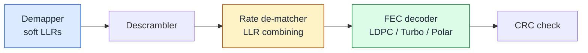

<SectionCover
  :part="2"
  title="The Toolbox"
  thesis="Before the heroes: parity, distance, and — the deck's special guest — soft bits."
/>

<!--
Part 2 — The Toolbox. The conceptual kit every code family reuses: block codes,
redundancy, distance, and the probabilistic view (LLRs). After this part the
audience thinks in soft bits. Interactive components HammingPlayground and
LlrVisualizer are embedded and drive the soft-bit demos.
-->

---
layout: default
class: px-10
---

# Codes 101 — spending redundancy

A block code maps $k$ data bits to $n$ transmitted bits.

k data bits
+
n−k parity bits
=
n coded bits

- **Code rate** $\Rcode = k/n$ — how much of the pipe carries payload.
- **Systematic**: the $k$ data bits appear verbatim, parity appended. **Non-systematic**: data is mixed in.
- The encoder adds **structure**; the decoder **exploits** that structure to undo errors.

Weak use of redundancy

<b>Rate ⅓ repetition</b> — "say it three times":

0 → 000  ·  1 → 111

Triples the cost, corrects one flip by majority vote. Correct but
wasteful.

The whole game of Parts 3–5: spend the same redundancy far more cleverly —
<b>where</b> you put the parity is everything.

<!--
Slide 2. Vocabulary the audience half-knows, made precise. The repetition code is
the strawman: it "works" but wastes the pipe. Plant the thesis — modern codes
spend the SAME n−k parity bits with vastly more leverage. No heavy citation
needed; this is definitional.
-->

---
layout: default
class: px-10
clicks: 2
---

# Hamming (7,4) — the first real code

Four data bits, three parity bits. One error: located and fixed. Two errors: fooled — that's the lesson.

<HammingPlayground />

<TriviaCard class="mt-3" title="Hamming's weekend rage">
Bell Labs, 1949: batch jobs ran unattended over the weekend, and one relay fault
aborted the lot. <em>"If the machine can detect an error, why can't it locate and
correct it?"</em> The (7,4) code — a <b>perfect</b> single-error-correcting code —
was the answer. Its descendant (SECDED) still guards the ECC RAM in servers today.
<template #source>Hamming 1950, BSTJ 29(2); Hamming's 1995 NPS lecture transcript.</template>
</TriviaCard>

<SourceFoot :refs="[['Hamming 1950, BSTJ 29(2)', ''], ['(7,4) is a perfect code — standard result']]" />

<!--
Slide 3. INTERACTIVE — HammingPlayground (T05). Click choreography (2 clicks):
rest = encoded clean codeword; click 1 = single flip (position 5) → syndrome
points at it → corrected (green); click 2 = second flip (position 2) → syndrome
aliases to position 7 → miscorrection banner. The two-error failure is the
pedagogical payload (motivates d_min next slide). Free exploration also works:
click any data bit to toggle, any received bit to flip. Hamming weekend-rage
anecdote lives here (the code's home), not on the Part 1 timeline.
-->

---
layout: default
class: px-10
---

# Distance decides everything

The **minimum distance** $d_\text{min}$ — the fewest bit flips that turn one
codeword into another — sets what a code can do:

$$ t = \left\lfloor \tfrac{d_\text{min}-1}{2} \right\rfloor \text{ errors corrected} $$

Picture each codeword as the centre of a sphere of radius $t$. Received words
inside a sphere decode to its centre. **Non-overlapping spheres ⇒ correct
decoding.** Hamming (7,4) has $d_\text{min}=3 \Rightarrow t=1$.

Shannon's insight: big, almost-random codes have large $d_\text{min}$ and are excellent — but decoding one naively means comparing against $2^k$ codewords. Modern codes buy that distance with <b>structure</b> you can actually decode.

<svg viewBox="0 0 300 210" class="w-full h-auto max-h-72" role="img" aria-label="Sphere-packing picture">
  <!-- two codewords with radius-t spheres -->
  <circle cx="95" cy="115" r="50" style="fill: var(--fec-info); stroke: var(--fec-info)" fill-opacity="0.10" stroke-width="1.5" stroke-dasharray="4 4" />
  <circle cx="205" cy="115" r="50" style="fill: var(--fec-info); stroke: var(--fec-info)" fill-opacity="0.10" stroke-width="1.5" stroke-dasharray="4 4" />
  <circle cx="95" cy="115" r="5" style="fill: var(--fec-info)" />
  <circle cx="205" cy="115" r="5" style="fill: var(--fec-info)" />
  <text x="95" y="185" text-anchor="middle" style="fill: var(--fec-fg); font-size: 12px">codeword A</text>
  <text x="205" y="185" text-anchor="middle" style="fill: var(--fec-fg); font-size: 12px">codeword B</text>
  <!-- a received point near A, still corrected -->
  <circle cx="120" cy="97" r="4" style="fill: var(--fec-error)" />
  <line x1="95" y1="115" x2="120" y2="97" style="stroke: var(--fec-corrected)" stroke-width="1.5" />
  <text x="150" y="30" text-anchor="middle" style="fill: var(--fec-corrected); font-size: 12px">≤ t flips → still fixed</text>
  <!-- distance bracket -->
  <line x1="95" y1="140" x2="205" y2="140" style="stroke: var(--fec-muted)" stroke-width="1" />
  <text x="150" y="156" text-anchor="middle" style="fill: var(--fec-muted); font-size: 11px">d_min</text>
</svg>

<SourceFoot :refs="[['Sphere-packing / d_min bound — standard coding theory', '']]" />

<!--
Slide 4. Why distance is the master parameter, and the bridge to modern codes:
random-ish codes are great (big d_min) but naive decoding is exponential. The
tension — good distance vs decodable structure — is the entire motivation for
LDPC/Turbo/Polar. The SVG is a static sphere-packing intuition, one v-click for
the spheres, one for the Shannon caveat.
-->

---
layout: two-cols
class: px-6
---

# The receiver's real problem

The demodulator does not hand the decoder bits. It hands it a **cloud** — a soft
observation smeared by noise.

**Hard decision** slices each sample to 0/1 at the boundary and throws the rest
away. A sample that landed *just barely* on the wrong side is now a confident lie.

Keeping the softness is worth real power:

<BigNumber value="≈ 2 dB" label="Soft-decision gain over hard decision" source="Gibson 2017; CCSDS 130.1-G-1" color="corrected" />

::right::

<ConstellationCloud
  :order="4"
  :sigma="0.82"
  :boundaries="true"
  caption="Red = mis-sliced by the hard slicer — its softness would have saved it."
/>

<SourceFoot :refs="[['Gibson, Mobile Communications Handbook (2017)', ''], ['CCSDS 130.1-G-1: hard-decision loss > 2 dB (K=7 Viterbi)']]" />

<!--
Slide 5. The motivation for soft decoding, made visual: the red points on the
constellation crossed a decision boundary and would be errors under hard slicing
— but they're low-confidence, so soft decoding rescues most of them. The ≈2 dB is
the headline number. Reuses ConstellationCloud with boundaries on.
-->

---
layout: default
class: px-10
---

# LLR — the currency of modern receivers

$$ \LLR(b) = \ln\frac{\Prob(b=0 \mid y)}{\Prob(b=1 \mid y)} $$

<b>Sign</b> = the decision
+ → bit 0 · − → bit 1

<b>Magnitude</b> = the confidence
|LLR| large → sure · ≈ 0 → a coin flip

For BPSK over AWGN it collapses to something you can compute in one line:

$$ \LLR = \frac{2y}{\sigma^2} $$

<b>Notation, fixed for the whole deck.</b> A positive
LLR means bit <b>0</b> is more likely (3GPP / MATLAB polarity). We never redefine this.

<SourceFoot :refs="[['LLR definition &amp; BPSK 2y/σ² — standard; polarity per 3GPP/MATLAB', '']]" />

<!--
Slide 6. THE notation slide — every later part points back here. KaTeX stepping
(4 clicks: definition → sign/magnitude → BPSK formula → the polarity convention
box). Hammer the convention: positive ⇒ 0. Part 4's extrinsic-info exchange and
Part 3's BP messages both assume it.
-->

---
layout: default
class: px-10
---

# See the confidence move

Drag the received sample across zero → the decision flips exactly at 0. Grow the
noise → the LLR bar shrinks. Then a QAM tab: not all bits are equally reliable.

<LlrVisualizer />

<SourceFoot :refs="[['BPSK LLR = 2y/σ²; 16QAM max-log demapping — MathWorks demod docs', '']]" />

<!--
Slide 7. INTERACTIVE — LlrVisualizer (T05). Tab 1 (BPSK/AWGN): drag the received
sample y → LLR bar and decision colour flip exactly at 0; grow σ → the curves
overlap and |LLR| collapses. Tab 2 (Repetition): slide 8's canonical case, live.
Tab 3 (16QAM): max-log demapping — outer bits reliable, inner bits weak,
foreshadowing why bit positions onto QAM carriers get interleaved (Part 3 rate
matching). Free exploration — no click budget on this slide.
-->

---
layout: default
class: px-10
---

# Worked example — soft beats hard

Repetition code, bit <b>0</b> sent as (+1,+1,+1). Channel σ²=0.5, so LLR = 2y/σ² = <b>4y</b>. Received y = (+0.9, −0.15, −0.25).

Hard decision — majority vote

<table class="fec-tnum w-full mt-2">
<tbody>
<tr class="text-fec-muted text-sm"><td>y</td><td class="text-right">bit</td></tr>
<tr><td>+0.90</td><td class="text-right">0</td></tr>
<tr><td>−0.15</td><td class="text-right text-fec-error">1</td></tr>
<tr><td>−0.25</td><td class="text-right text-fec-error">1</td></tr>
</tbody>
</table>

Majority of (0,1,1) → decodes 1 — <b>wrong.</b>

Soft decision — sum the LLRs

<table class="fec-tnum w-full mt-2">
<tbody>
<tr class="text-fec-muted text-sm"><td>4y</td><td class="text-right">LLR</td></tr>
<tr><td>4 × +0.90</td><td class="text-right">+3.6</td></tr>
<tr><td>4 × −0.15</td><td class="text-right">−0.6</td></tr>
<tr><td>4 × −0.25</td><td class="text-right">−1.0</td></tr>
<tr class="border-t border-fec-line"><td class="font-semibold">sum</td><td class="text-right font-bold text-fec-corrected">+2.0</td></tr>
</tbody>
</table>

Sum &gt; 0 → decodes 0 — <b>right.</b>

Two low-confidence wrongs (−0.6, −1.0) lose to <b>one</b> high-confidence right (+3.6). Softness carries the information hard slicing discarded.

<SourceFoot :refs="[['Self-consistent example: 2/σ² = 4 for σ²=0.5 (T04 slide 8)', '']]" />

<!--
Slide 8. The money slide of Part 2. Numbers are exact and self-consistent
(σ²=0.5 ⇒ scale 4; sum = 3.6−0.6−1.0 = +2.0). Click 1 shows hard failing, click 2
shows soft succeeding on the SAME samples, click 3 states the moral. This is the
concrete proof of the ≈2 dB claim from slide 5.
-->

---
layout: default
class: px-10
---

# Everything from here is message passing

Decoding is **Bayesian inference on a graph of constraints**. Iterative decoders
don't "look up" the answer — they *negotiate* beliefs (LLRs) until they agree.

<b>Where the LLRs live in 5G.</b> The DL-SCH receive chain carries <em>soft</em>
values from the demapper all the way to the decoder — the rate de-matcher even
<b>combines</b> LLRs across HARQ transmissions (Part 6).

The toolbox is complete: parity, distance, and soft bits. Now meet the three code
families that put them to work.

<SourceFoot :refs="[['Receive-chain order: MathWorks \'DL-SCH and PDSCH processing chain\'', '']]" />

<!--
Slide 9. Close Part 2 by reframing decoding as message passing on a graph — the
thesis that carries into Parts 3–5. The Mermaid chain grounds it in the actual 5G
DL-SCH receive path a listener knows, and flags the rate de-matcher's LLR
combining as the hook for HARQ in Part 6. Two-click payoff: 5G context, then the
handoff.
-->
