<SectionCover
  :part="3"
  year="1962"
  title="LDPC — the workhorse of 5G data"
  thesis="Sparse graphs + message passing; QC structure = Gbps decoding."
>

Invented <b class="text-fec-fg">1962</b> · shelved ~35 years · deployed <b class="text-fec-fg">2003</b> (DVB-S2) · everywhere by <b class="text-fec-fg">2018</b> (5G NR data).

</SectionCover>

<!--
Part 3 — LDPC, the deepest section of the deck. Arc: sparse matrices → Tanner
graphs → message passing (the centerpiece simulator) → the decoding math →
schedules → structured encoding → the 5G NR specifics an L1/L2 engineer can map
onto their stack (base graphs, lifting, puncturing, TB→codeword, rate matching)
→ performance → why LDPC won the 2016 data-channel decision. TannerBpSimulator
(T07) embeds on slides 6 and 8 as placeholders until it lands.
-->

---
layout: default
class: px-10
---

# The man who was 40 years early

Robert **Gallager** introduced low-density parity-check codes in his **1960 MIT
thesis** and **1962** IRE paper. Then the field **shelved them for ~35 years** —
iterative decoding was "prohibitively expensive" for 1960s hardware.

They were **rediscovered** by **MacKay & Neal (1996)** — just as silicon finally
caught up. Within five years the theory was essentially complete.

The teacher–student twist: <b>Erdal Arıkan</b>, who invented <b>polar codes</b>
(Part 5), was <b>Gallager's PhD student</b>. In 5G, <em>data rides the professor's
code; control rides the student's.</em>

<TriviaCard title="Vindicated to four decimal places">
By <b>2001</b>, Chung, Forney, Richardson & Urbanke built a rate-½ irregular LDPC
whose threshold sat just <b>0.0045 dB</b> from the Shannon limit — a simulated
gap of ~0.04 dB at block length 10⁷. Gallager's 1962 idea turned out to be one of
the best codes ever found; the world was simply 35 years too early to decode it.
<template #icon>
</template>
<template #source>Gallager 1962, IRE Trans. IT 8(1); MacKay–Neal 1996, Electron. Lett. 32(18); Chung et al. 2001, IEEE Comm. Lett. 5(2).</template>
</TriviaCard>

<SourceFoot :refs="[['Gallager 1962, IRE Trans. IT 8(1):21–28', ''], ['MacKay &amp; Neal 1996, Electron. Lett. 32(18)', ''], ['Chung et al. 2001, IEEE Comm. Lett.', '']]" />

<!--
Slide 2. History + two hooks. The 0.0045 dB TriviaCard is the emotional anchor
(callback to Part 1 slide 13). The Arıkan-was-Gallager's-student fact plants the
Part 5 tease. Keep the shelved-35-years beat — it reframes LDPC as a hardware
story, not a theory story.
-->

---
layout: default
class: px-10
---

# From parity-check matrix to Tanner graph

A small rate-½ <b>(6,3)</b> code, <b>(2,3)-regular</b>: every column has weight 2, every row weight 3. Columns are variable nodes, rows are check nodes, a <b>1</b> is an edge.

<table class="fec-tnum hmat">
<thead><tr><th></th><th>v₁</th><th>v₂</th><th>v₃</th><th>v₄</th><th>v₅</th><th>v₆</th></tr></thead>
<tbody>
<tr><th>c₁</th><td class="on">1</td><td class="on">1</td><td>0</td><td class="on">1</td><td>0</td><td>0</td></tr>
<tr><th>c₂</th><td>0</td><td class="on">1</td><td class="on">1</td><td>0</td><td class="on">1</td><td>0</td></tr>
<tr><th>c₃</th><td class="on">1</td><td>0</td><td>0</td><td>0</td><td class="on">1</td><td class="on">1</td></tr>
<tr><th>c₄</th><td>0</td><td>0</td><td class="on">1</td><td class="on">1</td><td>0</td><td class="on">1</td></tr>
</tbody>
</table>

Row c₁ touches v₁, v₂, v₄ → the constraint v₁ ⊕ v₂ ⊕ v₄ = 0.

<svg viewBox="0 0 440 210" class="w-full h-auto" role="img" aria-label="Tanner graph of the (6,3) code">
  <!-- edges -->
  <g stroke-width="1.4" :style="{ stroke: 'var(--fec-line)' }">
    <line x1="85" y1="42" x2="45" y2="165" /><line x1="85" y1="42" x2="109" y2="165" /><line x1="85" y1="42" x2="237" y2="165" />
    <line x1="173" y1="42" x2="109" y2="165" /><line x1="173" y1="42" x2="173" y2="165" /><line x1="173" y1="42" x2="301" y2="165" />
    <line x1="261" y1="42" x2="45" y2="165" /><line x1="261" y1="42" x2="301" y2="165" /><line x1="261" y1="42" x2="365" y2="165" />
    <line x1="349" y1="42" x2="173" y2="165" /><line x1="349" y1="42" x2="237" y2="165" /><line x1="349" y1="42" x2="365" y2="165" />
  </g>
  <!-- highlight c₁'s edges + nodes on click -->
  <g v-click>
    <g stroke-width="2.6" :style="{ stroke: 'var(--fec-corrected)' }">
      <line x1="85" y1="42" x2="45" y2="165" /><line x1="85" y1="42" x2="109" y2="165" /><line x1="85" y1="42" x2="237" y2="165" />
    </g>
  </g>
  <!-- check nodes (squares) -->
  <g>
    <template v-for="(cx, i) in [85,173,261,349]" :key="`c${i}`">
      <rect :x="cx-13" y="29" width="26" height="26" rx="4" :style="{ fill: 'var(--fec-parity-soft)', stroke: 'var(--fec-parity)' }" stroke-width="2" />
      <text :x="cx" y="47" text-anchor="middle" style="font-size:12px;font-weight:700" :style="{ fill: 'var(--fec-parity)' }">c{{ i+1 }}</text>
    </template>
  </g>
  <!-- variable nodes (circles) -->
  <g>
    <template v-for="(vx, i) in [45,109,173,237,301,365]" :key="`v${i}`">
      <circle :cx="vx" cy="165" r="14" :style="{ fill: 'var(--fec-info-soft)', stroke: 'var(--fec-info)' }" stroke-width="2" />
      <text :x="vx" y="169" text-anchor="middle" style="font-size:12px;font-weight:700" :style="{ fill: 'var(--fec-info)' }">v{{ i+1 }}</text>
    </template>
  </g>
</svg>

Check c₁ is one parity referee, watching bits v₁, v₂, v₄.

<SourceFoot :refs="[['(2,3)-regular example: S. Johnson, \'Introducing LDPC Codes\'', ''], ['Tanner 1981, IEEE Trans. IT 27(5)']]" />

<!--
Slide 3. The core representation. Matrix on the left, the SAME code as a bipartite
Tanner graph on the right — this exact (6,3) code carries through the BEC demo
(slide 5) and the TannerBpSimulator (slides 6/8, T07). One click highlights c₁'s
three edges so the row↔check↔edges mapping lands. Colour code is binding:
variable nodes blue, check nodes amber.
-->

---
layout: default
class: px-10
---

# Sparse is the whole point

"Low-density" is literal: only a handful of 1s per row and column, however large
the code. That sparsity is what makes iterative decoding **cheap** and **local** —
each check talks to only a few bits.

- **Regular** (fixed row/column weights) vs **irregular** (a designed mix of
  degrees). Irregular codes with tuned **degree distributions** get closer to
  capacity — that's how the 0.0045 dB code was built.

- **Girth matters.** Short cycles — especially **length-4** — feed a node's own
  belief back to it, breaking message passing's independence assumption. Good
  constructions (**PEG**, and 5G's structured design) maximise girth.

<svg viewBox="0 0 300 170" class="w-full h-auto max-h-52" role="img" aria-label="A length-4 cycle in a Tanner graph">
  <line x1="80" y1="40" x2="80" y2="130" :style="{ stroke: 'var(--fec-error)' }" stroke-width="2.4" />
  <line x1="80" y1="40" x2="220" y2="130" :style="{ stroke: 'var(--fec-error)' }" stroke-width="2.4" />
  <line x1="220" y1="40" x2="80" y2="130" :style="{ stroke: 'var(--fec-error)' }" stroke-width="2.4" />
  <line x1="220" y1="40" x2="220" y2="130" :style="{ stroke: 'var(--fec-error)' }" stroke-width="2.4" />
  <rect x="67" y="27" width="26" height="26" rx="4" :style="{ fill: 'var(--fec-parity-soft)', stroke: 'var(--fec-parity)' }" stroke-width="2" />
  <rect x="207" y="27" width="26" height="26" rx="4" :style="{ fill: 'var(--fec-parity-soft)', stroke: 'var(--fec-parity)' }" stroke-width="2" />
  <circle cx="80" cy="130" r="14" :style="{ fill: 'var(--fec-info-soft)', stroke: 'var(--fec-info)' }" stroke-width="2" />
  <circle cx="220" cy="130" r="14" :style="{ fill: 'var(--fec-info-soft)', stroke: 'var(--fec-info)' }" stroke-width="2" />
  <text x="150" y="150" text-anchor="middle" style="font-size:12px" :style="{ fill: 'var(--fec-error)' }">a 4-cycle: belief echoes back</text>
</svg>

<SourceFoot :refs="[['Degree distributions: Richardson &amp; Urbanke 2001', ''], ['PEG: Hu, Eleftheriou &amp; Arnold 2005, IEEE Trans. IT 51(1)']]" />

<!--
Slide 4. Intuition only — no heavy math. Two ideas the audience must carry into
decoding: irregular degree distributions buy the last fraction of a dB, and short
cycles (girth) are the enemy of belief propagation. The 4-cycle sketch makes
"echoes back" concrete. Keep it light; 5G's base graphs are engineered to avoid
exactly this.
-->

---
layout: default
class: px-10
---

# Decoding, the idea: bits and referees gossip

Warm-up on the <b>erasure</b> channel (bits arrive as 0, 1, or <b>?</b>). Same (6,3) code. Received ? 1 ? 0 0 ? — three erasures. A check with exactly <b>one</b> unknown can solve it.

  Received
  ?1?
  00?
  v₁…v₆ &nbsp;(erased = ?)

Round 1 — one-unknown checks fire

<b>c₁</b>: v₁ = v₂ ⊕ v₄ = 1 ⊕ 0 = <b class="text-fec-corrected">1</b>

<b>c₂</b>: v₃ = v₂ ⊕ v₅ = 1 ⊕ 0 = <b class="text-fec-corrected">1</b>

  111
  00?

Round 2 — v₆ now has a single unknown

<b>c₃</b>: v₆ = v₁ ⊕ v₅ = 1 ⊕ 0 = <b class="text-fec-corrected">1</b>

c₄ independently agrees: v₃ ⊕ v₄ = 1 ⊕ 0 = 1 ✓

  111
  001

Local checks, passed as messages, recover the whole word in <b>2 rounds</b>. On a real channel the messages aren't 0/1 — they're <b class="text-fec-info">LLRs</b>.

<SourceFoot :refs="[['Iterative erasure decoding — standard BP warm-up', ''], ['Values verified against the (6,3) code above']]" />

<!--
Slide 5. Message passing without the math, on the erasure channel where it's
just logic. Click choreography IS the algorithm: round 1 resolves v₁,v₃; round 2
resolves v₆ (c₃ and c₄ agree — a taste of redundant evidence). Numbers are
verified on the slide-3 code. Punchline (click 3): real channels replace 0/1/?
with LLRs → the simulator next.
-->

---
layout: default
class: px-10
---

# Interactive — belief propagation, step by step

The centerpiece. Sum-product on the (6,3) graph with real LLRs: one flipped bit, watch the checks argue it back.

<SimStub
  name="TannerBpSimulator · guided run"
  task="T07"
  note="BSC p=0.2 → channel LLRs ±1.386. Bit 1 received flipped. Step the iterations: CN→VN messages (±0.7538) flow back and correct bit 1's posterior to +0.1213 in ONE iteration; syndrome satisfied → stop."
  height="15rem"
/>

<SourceFoot :refs="[['Worked numbers: S. Johnson, \'Introducing LDPC Codes\' (ex. 2.5)', ''], ['Sum-product / tanh rule — Gallager 1962']]" />

<!--
Slide 6. INTERACTIVE — TannerBpSimulator guided run (T07, centerpiece #1). Exact
numbers for the presenter: BSC p=0.2 ⇒ channel LLR = ln((1−p)/p) = ±1.386; CN→VN
extrinsic ±0.7538; bit 1 posterior → +0.1213 after one iteration; parity check
passes → early stop. Placeholder until T07 lands.
-->

---
layout: default
class: px-10
---

# Decoding, the math

Check node → variable (the tanh rule)

$$ \tanh\frac{L_{c\to v}}{2} = \prod_{v' \in N(c)\setminus v} \tanh\frac{L_{v'\to c}}{2} $$

A check is only as sure as its <em>least</em>-sure input.

Variable node → check, and the posterior

$$ L_{v\to c} = L_v^{\text{ch}} + \!\!\sum_{c'\in N(v)\setminus c}\!\! L_{c'\to v}, \qquad L_v = L_v^{\text{ch}} + \!\!\sum_{c\in N(v)}\!\! L_{c\to v} $$

Each node adds up everything it hears **except** the message it's replying to (extrinsic only).

<b>Min-sum</b> — drop the tanh, keep the behaviour:

$$ L_{c\to v} \approx \Big(\textstyle\prod \operatorname{sign} L_{v'\to c}\Big)\cdot \min_{v'}\, |L_{v'\to c}| $$

Sign of the product, magnitude of the weakest. Cheap enough for hardware.

Plain min-sum <b>overestimates</b> confidence. Two standard fixes:

· <b>normalized</b>: scale by <b>α ≈ 0.75</b> &nbsp; · <b>offset</b>: subtract <b>β = 0.5</b>

MATLAB <code>nrLDPCDecode</code> defaults; recovers most of the sum-product gain.

<SourceFoot :refs="[['Sum-product / min-sum — Gallager 1962; Fossorier et al. 1999', ''], ['α=0.75, β=0.5 defaults: MathWorks nrLDPCDecode', '']]" />

<!--
Slide 7. The actual update rules, stepped (4 clicks): tanh CN rule → VN sum +
posterior → min-sum approximation → the normalized/offset corrections. Hammer
"extrinsic only" (the N(·)\{·} exclusion) — it's the same idea Turbo will exploit
in Part 4. The α/β numbers are MATLAB defaults, sourced.
-->

---
layout: default
class: px-10
---

# Interactive — sum-product vs min-sum

Same received word, three algorithms. Watch the message magnitudes — and how many iterations each needs.

<SimStub
  name="TannerBpSimulator · algorithm toggle"
  task="T07"
  note="Toggle sum-product ↔ min-sum ↔ normalized min-sum on the same flipped word. The CN→VN message changes: 0.7538 (sum-product) vs 1.3863 (plain min-sum, over-confident) vs 1.0397 (normalized, ×0.75). Convergence compared side by side."
  height="14rem"
/>

0.7538

sum-product (exact)

1.3863

min-sum (over-confident)

1.0397

normalized ×0.75

<SourceFoot :refs="[['Message values: S. Johnson worked example; α=0.75 normalization', '']]" />

<!--
Slide 8. INTERACTIVE — TannerBpSimulator algorithm toggle (T07). The three
message magnitudes are the teaching point: min-sum's 1.3863 is visibly larger
than sum-product's 0.7538 (over-confidence), and ×0.75 pulls it back to 1.0397.
The static cards below stand in / reinforce until the sim lands.
-->

---
layout: default
class: px-10
---

# Schedules, iterations, and quantization

Flooding vs layered

Update all nodes at once (<b>flooding</b>) or check-group by check-group
(<b>layered</b>). Layered propagates within an iteration, so it converges in
about <b>half</b> the iterations.

How many iterations?

Real modems run <b>~8–25</b>, with <b>early termination</b> the moment parity
(or CRC) is satisfied. NVIDIA cuPHY defaults to <b>10</b>; ASIC surveys quote
<b>~25</b> as a min-sum ceiling.

LLR quantization

Hardware doesn't carry floats. <b>6-bit</b> LLRs are the industry sweet spot —
near-floating-point BLER at a fraction of the area and power.

Every one of these is a knob a modem designer turns to trade a fraction of a dB against silicon area, power, and latency.

<SourceFoot :refs="[['Layered ≈ half iterations: MathWorks; arXiv:2502.11053', ''], ['I=10: NVIDIA pyAerial · I≈25: Shao et al. survey, IEEE CS&amp;T 2019', ''], ['6-bit LLR: Intel FPGA LDPC IP docs', '']]" />

<!--
Slide 9. The practical decoder knobs, three cards. Layered halves iterations;
8–25 iterations with early termination; 6-bit LLR quantization. These are the
numbers an L1 engineer will actually meet in a datasheet. "8–25 typical" is
blog-grade (CafeTele) — the sourced anchors are NVIDIA's 10 and Shao's 25 (flag
for T15).
-->

---
layout: default
class: px-10
---

# Encoding — why structure beats a generator matrix

The textbook route — build $G$ from $H$, multiply — makes $G$ **dense**:
encoding costs $O(n^2)$. Fatal at 5G block lengths.

5G's **raptor-like QC-LDPC** designs $H$ so the parity part has a
**double-diagonal core** plus an **identity accumulate** tail. Parity bits fall
out by **back-substitution** — $O(n)$.

<BigNumber value="62–258 Gbps" label="Single 28 nm QC-LDPC encoder throughput" source="MDPI Sensors 21(18):6266" color="corrected" />

<svg viewBox="0 0 400 220" class="w-full h-auto" role="img" aria-label="5G QC-LDPC H-matrix structure">
  <!-- information columns -->
  <rect x="30" y="40" width="150" height="150" :style="{ fill: 'var(--fec-info-soft)', stroke: 'var(--fec-info)' }" stroke-width="1.5" />
  <text x="105" y="118" text-anchor="middle" style="font-size:13px;font-weight:700" :style="{ fill: 'var(--fec-info)' }">systematic</text>
  <text x="105" y="135" text-anchor="middle" style="font-size:11px" :style="{ fill: 'var(--fec-info)' }">Kb·Zc columns</text>
  <!-- double-diagonal core (top-right) -->
  <rect x="180" y="40" width="90" height="60" :style="{ fill: 'var(--fec-parity-soft)', stroke: 'var(--fec-parity)' }" stroke-width="1.5" />
  <text x="225" y="66" text-anchor="middle" style="font-size:11px;font-weight:700" :style="{ fill: 'var(--fec-parity)' }">double</text>
  <text x="225" y="80" text-anchor="middle" style="font-size:11px;font-weight:700" :style="{ fill: 'var(--fec-parity)' }">diagonal</text>
  <!-- identity accumulate (lower-right, staircase) -->
  <rect x="180" y="100" width="190" height="90" :style="{ fill: 'var(--fec-corrected-soft)', stroke: 'var(--fec-corrected)' }" stroke-width="1.5" />
  <g :style="{ stroke: 'var(--fec-corrected)' }" stroke-width="2">
    <line x1="285" y1="108" x2="285" y2="182" /><line x1="270" y1="110" x2="365" y2="180" />
  </g>
  <text x="285" y="150" text-anchor="middle" style="font-size:11px;font-weight:700" :style="{ fill: 'var(--fec-corrected)' }">identity</text>
  <text x="285" y="164" text-anchor="middle" style="font-size:11px;font-weight:700" :style="{ fill: 'var(--fec-corrected)' }">(accumulate)</text>
  <text x="200" y="210" text-anchor="middle" style="font-size:11px;font-style:italic" :style="{ fill: 'var(--fec-muted)' }">H = [ systematic | structured parity ]</text>
</svg>

<SourceFoot :refs="[['Raptor-like QC-LDPC encoding: Richardson &amp; Kudekar 2018', ''], ['Encoder throughput: MDPI Sensors 21(18):6266', ''], ['5G H structure: TS 38.212 §5.3.2']]" />

<!--
Slide 10. Encoding. The point: generic G is dense/O(n²); 5G's structured H
(double-diagonal core + identity accumulate) makes encoding linear-time
back-substitution. The block diagram zones H into systematic (blue) / core parity
(amber) / identity accumulate (green). Throughput headline grounds it.
-->

---
layout: default
class: px-10
---

# 5G NR: two base graphs, one lifting trick

<table class="fec-tnum bg-tbl">
<thead><tr><th></th><th>BG1</th><th>BG2</th></tr></thead>
<tbody>
<tr><th class="text-left">Base size (m×n)</th><td>46 × 68</td><td>42 × 52</td></tr>
<tr><th class="text-left">Systematic cols Kb</th><td>22</td><td>10</td></tr>
<tr><th class="text-left">Max info K</th><td>8448</td><td>3840</td></tr>
<tr><th class="text-left">Mother-code rate</th><td>1/3 → 8/9</td><td>1/5 → 2/3</td></tr>
<tr><th class="text-left">Built for</th><td class="text-fec-info">large, high-rate</td><td class="text-fec-info">small, low-rate</td></tr>
</tbody>
</table>

<b>Lifting.</b> Each base "1" becomes a <b>Zc × Zc circulant</b> (a cyclically
shifted identity); "−1" becomes an all-zero block. <b>51</b> lifting sizes
Zc = a·2j, a ∈ {2, 3, 5, 7, 9, 11, 13, 15}, from 2 to 384.

<svg viewBox="0 0 320 96" class="w-full h-auto mt-2" role="img" aria-label="Circulant lifting of one base cell">
  <rect x="6" y="34" width="30" height="30" rx="4" :style="{ fill: 'var(--fec-parity-soft)', stroke: 'var(--fec-parity)' }" stroke-width="1.5" />
  <text x="21" y="54" text-anchor="middle" style="font-size:13px;font-weight:700" :style="{ fill: 'var(--fec-parity)' }">3</text>
  <text x="70" y="53" text-anchor="middle" style="font-size:16px" :style="{ fill: 'var(--fec-muted)' }">→</text>
  <g>
    <template v-for="r in 6" :key="`lr${r}`">
      <template v-for="c in 6" :key="`lc${r}_${c}`">
        <rect :x="100 + (c-1)*18" :y="10 + (r-1)*13" width="16" height="11"
          :style="{ fill: ((r-1+3)%6 === (c-1)) ? 'var(--fec-info)' : 'var(--fec-surface-2)', stroke: 'var(--fec-line)' }" stroke-width="0.6" />
      </template>
    </template>
  </g>
  <text x="145" y="94" text-anchor="middle" style="font-size:10px" :style="{ fill: 'var(--fec-muted)' }">Zc × Zc identity, cyclically shifted by 3</text>
</svg>

Which base graph? (info size A vs code rate R)

<svg viewBox="0 0 460 300" class="w-full h-auto" role="img" aria-label="Base-graph selection region chart">
  <!-- BG1 background -->
  <rect x="60" y="40" width="380" height="210" :style="{ fill: 'var(--fec-parity)' }" fill-opacity="0.14" />
  <!-- BG2 regions -->
  <rect x="60" y="40" width="13.1" height="210" :style="{ fill: 'var(--fec-info)' }" fill-opacity="0.22" />
  <rect x="73.1" y="109.3" width="158.9" height="140.7" :style="{ fill: 'var(--fec-info)' }" fill-opacity="0.22" />
  <rect x="232" y="197.5" width="208" height="52.5" :style="{ fill: 'var(--fec-info)' }" fill-opacity="0.22" />
  <!-- threshold guides -->
  <line x1="232" y1="40" x2="232" y2="250" :style="{ stroke: 'var(--fec-line)' }" stroke-dasharray="3 3" />
  <line x1="60" y1="109.3" x2="440" y2="109.3" :style="{ stroke: 'var(--fec-line)' }" stroke-dasharray="3 3" />
  <line x1="60" y1="197.5" x2="440" y2="197.5" :style="{ stroke: 'var(--fec-line)' }" stroke-dasharray="3 3" />
  <!-- region labels -->
  <text x="140" y="230" text-anchor="middle" style="font-size:15px;font-weight:800" :style="{ fill: 'var(--fec-info)' }">BG2</text>
  <text x="345" y="95" text-anchor="middle" style="font-size:15px;font-weight:800" :style="{ fill: 'var(--fec-parity)' }">BG1</text>
  <!-- axes -->
  <line x1="60" y1="250" x2="440" y2="250" :style="{ stroke: 'var(--fec-fg)' }" stroke-width="1" />
  <line x1="60" y1="40" x2="60" y2="250" :style="{ stroke: 'var(--fec-fg)' }" stroke-width="1" />
  <g style="font-size:10px" :style="{ fill: 'var(--fec-muted)' }" text-anchor="middle">
    <text x="60" y="264">0</text><text x="232" y="264">3824</text><text x="440" y="264">8448</text>
    <text x="140" y="278" style="font-size:11px;font-style:italic">info bits A</text>
  </g>
  <g style="font-size:10px" :style="{ fill: 'var(--fec-muted)' }" text-anchor="end">
    <text x="55" y="253">0</text><text x="55" y="201">0.25</text><text x="55" y="113">0.67</text><text x="55" y="44">1.0</text>
  </g>
  <text x="20" y="150" text-anchor="middle" style="font-size:11px;font-style:italic" transform="rotate(-90 20 150)" :style="{ fill: 'var(--fec-muted)' }">code rate R</text>
</svg>

BG2 if A ≤ 292, or (A ≤ 3824 ∧ R ≤ 0.67), or R ≤ 0.25 — else BG1.

<SourceFoot :refs="[['BG1/BG2 dims, Kb, Zc set, selection rule: TS 38.212 §5.2.2–5.3.2', ''], ['Triangulated: ShareTechnote, CafeTele, srsRAN code', '']]" />

<!--
Slide 11. The 5G-specific heart. Left: BG1 (big/high-rate) vs BG2 (small/low-rate)
comparison + the circulant lifting trick (base cell "3" → 6×6 shifted identity).
Right: the BG-selection region chart — the single most useful takeaway for an L2
engineer, rendered directly from the three-condition rule (BG2 iff A≤292 ∨
(A≤3824 ∧ R≤0.67) ∨ R≤0.25). Spec numbers flagged for T15 re-verification.
-->

---
layout: default
class: px-10
---

# The hidden trick: punctured state bits

The first **2·Zc** systematic columns are the **highest-degree** variable nodes —
they touch the most checks. 5G **never transmits them**.

The decoder simply initialises them to $\LLR = 0$ (pure "don't know") and lets
message passing fill them in from their many connections.

The code <b>transmits less than it knows</b>. Spending those parity checks on
hidden, well-connected bits <b>lowers the waterfall</b> for free — you pay no
airtime for the two strongest columns.

<svg viewBox="0 0 380 150" class="w-full h-auto" role="img" aria-label="First 2·Zc columns punctured (not transmitted)">
  <template v-for="i in 14" :key="`col${i}`">
    <rect :x="20 + (i-1)*25" y="45" width="20" height="60"
      :style="{ fill: i<=2 ? 'var(--fec-frozen-soft)' : 'var(--fec-info-soft)', stroke: i<=2 ? 'var(--fec-frozen)' : 'var(--fec-info)' }"
      stroke-width="1.5" :stroke-dasharray="i<=2 ? '3 3' : '0'" />
  </template>
  <text x="45" y="35" text-anchor="middle" style="font-size:11px;font-weight:700" :style="{ fill: 'var(--fec-frozen)' }">2·Zc</text>
  <text x="45" y="125" text-anchor="middle" style="font-size:10px" :style="{ fill: 'var(--fec-frozen)' }">punctured</text>
  <text x="45" y="137" text-anchor="middle" style="font-size:10px" :style="{ fill: 'var(--fec-frozen)' }">(LLR = 0)</text>
  <text x="240" y="125" text-anchor="middle" style="font-size:10px" :style="{ fill: 'var(--fec-info)' }">transmitted columns →</text>
</svg>

<SourceFoot :refs="[['2·Zc puncturing of systematic bits: TS 38.212 §5.3.2', ''], ['DSPRelated QC-LDPC article; arXiv:2502.11053', '']]" />

<!--
Slide 12. The counter-intuitive gem: the two highest-degree systematic column
blocks (2·Zc) are punctured — never sent — and the decoder inits them to LLR 0.
Because they're so well connected, message passing reconstructs them and the
waterfall improves. Sets up the "effective rate" story and teases HARQ (Part 6).
-->

---
layout: default
class: px-10
---

# From transport block to codeword — the L2 view

```mermaid {scale: 0.52}
graph LR
  TB["Transport block<br/>A = 640"] --> CRC["+ CRC16<br/>(A ≤ 3824)"]
  CRC --> B["B = 656"]
  B --> SEG["Segment @ Kcb=3840<br/>B ≤ Kcb ⇒ C = 1"]
  SEG --> LIFT["BG2 · Zc = 72<br/>K = 720 (64 filler)"]
  LIFT --> ENC["LDPC encode<br/>(N = 3600, K = 720)"]
  ENC --> RM["Rate matching<br/>+ interleave → PDSCH"]
  style TB fill:#dbeafe,stroke:#2563eb,color:#1e293b
  style B fill:#dbeafe,stroke:#2563eb,color:#1e293b
  style CRC fill:#fef3c7,stroke:#b45309,color:#1e293b
  style ENC fill:#dcfce7,stroke:#15803d,color:#1e293b
  style RM fill:#fef3c7,stroke:#b45309,color:#1e293b
```

Worked example: <b>SIB1</b>, A = 640 bits. One CB, BG2, Zc = 72 → a <b>(3600, 720)</b> LDPC codeword.

<b>CRC choice by size.</b> A > 3824 → <b>CRC24A</b>; else <b>CRC16</b>. When a TB is
split into C > 1 code blocks, each also gets its own <b>CRC24B</b> (enables
per-CB early termination).

<b>Segmentation.</b> Cap the code-block size at <b>Kcb = 8448</b> (BG1) / <b>3840</b>
(BG2). Bigger TBs are chopped into equal CBs — each rides its own LDPC codeword,
decoded in parallel.

<SourceFoot :refs="[['TB→CB chain, CRC polynomials, Kcb: TS 38.212 §5.1–5.2.2', ''], ['SIB1 walkthrough: Estévez, PDSCH decoding', '']]" />

<!--
Slide 13. The chain an L2 engineer owns, as a Mermaid pipeline, grounded in a
real SIB1 example (A=640 → CRC16 → B=656 → BG2, Zc=72 → (3600,720)). Two cards
detail the two size-driven decisions: CRC selection (24A/16/24B) and segmentation
at Kcb. Mermaid node fills are literal hex (mermaid can't read CSS vars) — matches
the deck's existing chart on Part 2 slide 9. Example flagged for T15.
-->

---
layout: default
class: px-10
---

# Rate matching & the circular buffer

The full mother codeword goes into a **circular buffer** of length $N = 66Z_c$
(BG1) / $50Z_c$ (BG2). Four **redundancy versions** (RV0–3) are just different
**start pointers** into it.

RV0–3 start at buffer fractions **0, 17/66, 33/66, 56/66** (BG1) and
**0, 13/50, 25/50, 43/50** (BG2) — read straight from production srsRAN code.

A <b>bit interleaver</b> writes Qm rows then reads columns, so the <b>systematic
bits land on the high-reliability QAM bit positions</b> — exactly the outer/inner
asymmetry from <b>Part 2</b>. (Full HARQ combining: Part 6.)

<svg viewBox="0 0 420 150" class="w-full h-auto" role="img" aria-label="Circular buffer with four RV start pointers">
  <!-- buffer bar -->
  <rect x="20" y="70" width="380" height="30" rx="4" :style="{ fill: 'var(--fec-surface-2)', stroke: 'var(--fec-line)' }" stroke-width="1.5" />
  <!-- systematic portion -->
  <rect x="20" y="70" width="115" height="30" rx="4" :style="{ fill: 'var(--fec-info-soft)', stroke: 'var(--fec-info)' }" stroke-width="1.5" />
  <text x="77" y="90" text-anchor="middle" style="font-size:10px" :style="{ fill: 'var(--fec-info)' }">systematic</text>
  <text x="270" y="90" text-anchor="middle" style="font-size:10px" :style="{ fill: 'var(--fec-muted)' }">parity →</text>
  <!-- RV pointers at 0, 17/66, 33/66, 56/66 of 380px -->
  <g style="font-size:11px;font-weight:700">
    <g :style="{ fill: 'var(--fec-corrected)' }"><line x1="20" y1="55" x2="20" y2="70" :style="{ stroke: 'var(--fec-corrected)' }" stroke-width="2" /><text x="20" y="48" text-anchor="middle">RV0</text></g>
    <g :style="{ fill: 'var(--fec-parity)' }"><line x1="118" y1="55" x2="118" y2="70" :style="{ stroke: 'var(--fec-parity)' }" stroke-width="2" /><text x="118" y="48" text-anchor="middle">RV1</text></g>
    <g :style="{ fill: 'var(--fec-parity)' }"><line x1="210" y1="55" x2="210" y2="70" :style="{ stroke: 'var(--fec-parity)' }" stroke-width="2" /><text x="210" y="48" text-anchor="middle">RV2</text></g>
    <g :style="{ fill: 'var(--fec-parity)' }"><line x1="342" y1="55" x2="342" y2="70" :style="{ stroke: 'var(--fec-parity)' }" stroke-width="2" /><text x="342" y="48" text-anchor="middle">RV3</text></g>
  </g>
  <!-- wrap arrow -->
  <path d="M 400 115 q 15 12 -15 12 L 35 127 q -15 0 0 -12" fill="none" :style="{ stroke: 'var(--fec-muted)' }" stroke-width="1.2" stroke-dasharray="4 3" />
  <text x="210" y="145" text-anchor="middle" style="font-size:10px" :style="{ fill: 'var(--fec-muted)' }">buffer wraps (circular) · RV0/1/2/3 at 0, 17/66, 33/66, 56/66</text>
</svg>

<SourceFoot :refs="[['RV start fractions: srsRAN ldpc_rate_matcher_impl.cpp; CafeTele', ''], ['Bit interleaver → QAM reliability: TS 38.212 §5.4.2', '']]" />

<!--
Slide 14. Rate matching. Two beats: (1) RV0–3 are start pointers into the N=66Zc
/ 50Zc circular buffer, fractions {0,17,33,56}/66 and {0,13,25,43}/50 verified vs
srsRAN source; (2) the bit interleaver maps systematic bits onto strong QAM
positions — an explicit callback to Part 2 slide 7's outer/inner LLR asymmetry.
One-sentence HARQ teaser; the full combining story is Part 6.
-->

---
layout: default
class: px-10
---

# Performance — waterfall and the floor

<svg viewBox="0 0 460 260" class="w-full h-auto" role="img" aria-label="BLER waterfall curves for three code rates">
  <!-- grid -->
  <g :style="{ stroke: 'var(--fec-line)' }" stroke-width="1">
    <line x1="55" y1="30" x2="55" y2="220" /><line x1="55" y1="220" x2="440" y2="220" />
    <line x1="55" y1="83" x2="440" y2="83" stroke-dasharray="2 4" /><line x1="55" y1="136" x2="440" y2="136" stroke-dasharray="2 4" /><line x1="55" y1="189" x2="440" y2="189" stroke-dasharray="2 4" />
  </g>
  <!-- 10% target -->
  <line x1="55" y1="57" x2="440" y2="57" :style="{ stroke: 'var(--fec-error)' }" stroke-width="1.2" stroke-dasharray="5 4" />
  <text x="440" y="52" text-anchor="end" style="font-size:10px" :style="{ fill: 'var(--fec-error)' }">10% BLER</text>
  <!-- y labels (log BLER) -->
  <g style="font-size:10px" :style="{ fill: 'var(--fec-muted)' }" text-anchor="end">
    <text x="50" y="34">1</text><text x="50" y="87">1e-2</text><text x="50" y="140">1e-4</text><text x="50" y="193">1e-6</text>
  </g>
  <!-- x labels (dB) -->
  <g style="font-size:10px" :style="{ fill: 'var(--fec-muted)' }" text-anchor="middle">
    <text x="55" y="234">-2</text><text x="151" y="234">0</text><text x="247" y="234">2</text><text x="343" y="234">4</text><text x="440" y="234">6</text>
    <text x="247" y="250" style="font-size:11px;font-style:italic">SNR (dB)</text>
  </g>
  <!-- R=1/3 curve (drops near -1 dB), floor ~1e-5 -->
  <polyline points="79,40 103,60 122,120 141,175 170,200 440,205" fill="none" :style="{ stroke: 'var(--fec-corrected)' }" stroke-width="2.4" />
  <text x="88" y="36" style="font-size:10px" :style="{ fill: 'var(--fec-corrected)' }">R=1/3</text>
  <!-- R=1/2 curve (~1 dB) -->
  <polyline points="151,40 175,58 199,120 223,178 260,202 440,206" fill="none" :style="{ stroke: 'var(--fec-info)' }" stroke-width="2.4" />
  <text x="165" y="36" style="font-size:10px" :style="{ fill: 'var(--fec-info)' }">R=1/2</text>
  <!-- R=2/3 curve (~3 dB) -->
  <polyline points="247,40 271,58 295,120 319,176 356,201 440,204" fill="none" :style="{ stroke: 'var(--fec-parity)' }" stroke-width="2.4" />
  <text x="262" y="36" style="font-size:10px" :style="{ fill: 'var(--fec-parity)' }">R=2/3</text>
</svg>

Schematic shapes. Sample points below are read off published curves (±0.2 dB).

Steep **waterfall**, then — in weaker codes — an **error floor** where trapping
sets stall the decoder. 5G LDPC is engineered so any floor sits **below BLER
1e-5** across rates.

BG2, K′ ≈ 1000 (Southampton 3D-EXIT)

<table class="fec-tnum w-full mt-1 text-sm">
<tbody>
<tr><td>R = 1/3</td><td class="text-right text-fec-corrected">BLER 1e-4 near −1 dB</td></tr>
<tr><td>R = 1/2</td><td class="text-right text-fec-info">≈ 1 dB</td></tr>
<tr><td>R = 2/3</td><td class="text-right text-fec-parity">≈ 3 dB</td></tr>
</tbody>
</table>

Lower rate → more parity → the waterfall shifts left. That dial is exactly the
subject of Part 6.

<SourceFoot :refs="[['Floor ≤ 1e-5; trapping sets: arXiv:2502.11053', ''], ['BLER sample points: Southampton 3D-EXIT (read off plots — T15)', '']]" />

<!--
Slide 15. Performance anatomy. Left: schematic waterfall for R=1/3, 1/2, 2/3 with
the 10% line and a flattening floor. Right: the error-floor story (trapping sets,
5G floors below 1e-5) plus sourced sample points. I explicitly label the plot
schematic; the numeric points are read off Southampton plots (±0.2 dB, flagged
for T15). Bridges to Part 6's rate dial.
-->

---
layout: default
class: px-10
---

# Why LDPC won the 5G data channel

The **2016** decision (3GPP RAN1 **#86bis Lisbon → #87 Reno**) put LDPC on eMBB
data. Three engineering reasons beat Turbo:

1.
<b>Parallelism.</b> Node updates run wide; Turbo's trellis is serial.

2.
<b>No meaningful floor</b> at the target BLERs.

3.
<b>Native rate flexibility</b> via lifting + the circular buffer.

<BigNumber value="20 Gbps" label="5G decoder throughput target (~0.665 µs budget)" color="info" />
<BigNumber value="52 Gbps" label="Record LDPC decoder ASIC" source="Shao et al. survey" color="corrected" />

<TriviaCard title="DVB-S2 got there first">
LDPC's first mass deployment was <b>DVB-S2</b> (2003) — satellite TV. In the
selection it <b>beat six Turbo proposals</b>, landing just <b>0.7–1.2 dB</b> from
Shannon, under a hard constraint: the decoder had to fit in <b>≤ 14 mm²</b> of
0.13 µm silicon. A BCH outer code mops up the floor.
<template #icon>
</template>
<template #source>EBU Tech Review 300 (Morello &amp; Mignone 2004).</template>
</TriviaCard>

At multi-Gbps, LDPC delivers roughly an <b>order of magnitude</b> better
Gbps/mm² than Turbo — the decisive number.

<SourceFoot :refs="[['RAN1 timeline &amp; throughput: Shao et al., IEEE Comm. Surveys &amp; Tutorials 2019', ''], ['DVB-S2: EBU Tech Review 300', '']]" />

<!--
Slide 16. The verdict. Three reasons LDPC beat Turbo for 5G data (parallelism,
no floor, rate flexibility), the throughput numbers (20 Gbps target, 52 Gbps
record, ~10× Gbps/mm² over turbo), and the DVB-S2 TriviaCard showing LDPC's first
win — beating six turbo proposals under a 14 mm² silicon budget. Sets up the
Turbo counter-story in Part 4 (LTE) and the epilogue comparison.
-->

---
layout: default
class: px-10
---

# Part 3 — LDPC plants its flag

<BigNumber value="0.0045 dB" label="Lab threshold from the Shannon limit (Chung et al. 2001)" color="corrected" />
<BigNumber value="~1–2 dB" label="Practical 5G NR operating gap" color="info" />

Where LDPC lives

5G data (NR)
Wi-Fi 6/7
DVB-S2/S2X
10GBASE-T
SSD / NAND
G.hn

<DbGauge
  class="mt-4"
  caption="LDPC plants its flag: essentially on the wall in the lab, ~1–2 dB out in a real 5G modem."
  :flags="[
    { label: 'LDPC (lab)', db: 0.04, color: 'corrected' },
    { label: 'LDPC (5G)', db: 1.4, color: 'info' },
  ]"
/>

<SourceFoot :refs="[['Chung et al. 2001, IEEE Comm. Lett. 5(2)', ''], ['5G practical gap: composite of Parts 3 sources — T15']]" />

<!--
Slide 17. Recap = plant the flag on the running DbGauge (the deck's connective
motif). Two numbers: 0.0045 dB in the lab (basically on the wall) and ~1–2 dB in
a shipping modem. The chip cloud shows LDPC is everywhere, not just 5G. Hand off
to Part 4: LDPC won 5G data, but Turbo won the 1993 revolution and still rides
every LTE link — and its story is stranger.
-->
