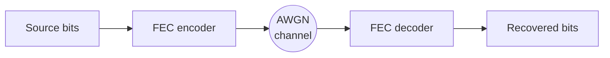

# Approaching Shannon

## Forward Error Correction for 5G Engineers

Noise is physics. FEC is why radio works. A story in seven parts.

<!--
Entry deck. Part 0 (Prologue) lives here; Parts 1–7 import from pages/ via `src:`.
The three "scaffold self-test" slides below verify the KaTeX / Mermaid / component
pipeline (T00 acceptance) and should be deleted once verified — T02 owns real Part 0.
-->

---

<!-- ══════════════ SCAFFOLD SELF-TEST — delete after T00 verification ══════════════ -->

# Scaffold self-test · KaTeX

Display math renders, and shared macros from `setup/katex.ts` resolve:

$$ C = B\log_2(1+\mathrm{SNR}) $$

Ultimate limit as $\Rcode \to 0$: $\EbNo \ge \ln 2 = -1.59\dB$.

---

# Scaffold self-test · Mermaid

---

# Scaffold self-test · components & clicks

Component auto-import from `components/` and `$clicks` both work:

<TriviaCard title="Pipeline check" class="mt-4 max-w-2xl">
If you can read this card, <code>components/</code> auto-imports correctly.
<template #source>Scaffold self-test — remove in T02.</template>
</TriviaCard>

✓ Click reveal fired — presenter-driven choreography is live.

<!-- ════════════════════════ END SCAFFOLD SELF-TEST ════════════════════════ -->

---

<SectionCover
  :part="0"
  title="Prologue — Every bit is a guess"
  thesis="Noise is physics; FEC is why radio works."
/>

<!--
Part 0 — Prologue. Section-cover placeholder (T00 skeleton).
Full Prologue slides implemented in T02.
-->

---
src: ./pages/part1-shannon.md
---

---
src: ./pages/part2-toolbox.md
---

---
src: ./pages/part3-ldpc.md
---

---
src: ./pages/part4-turbo.md
---

---
src: ./pages/part5-polar.md
---

---
src: ./pages/part6-bler.md
---

---
src: ./pages/part7-epilogue.md
---

---
# TODO(T16): set `hide: true` to drop the styleguide from the final deck.
src: ./pages/_styleguide.md
hide: false
---
